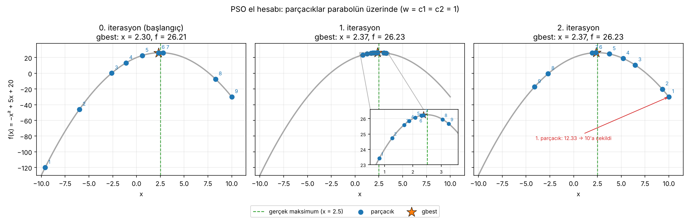
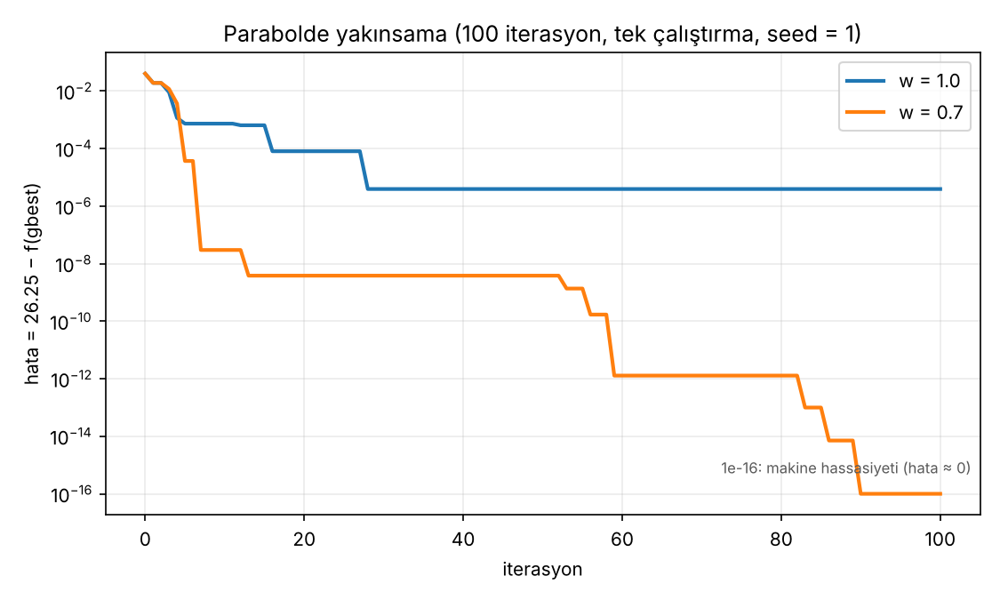
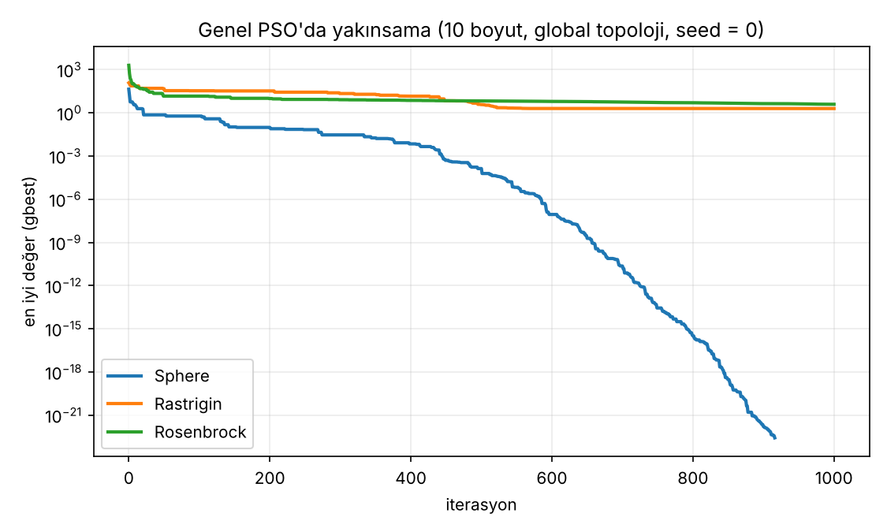

# Parçacık Sürü Optimizasyonu (PSO)

PSO'yu önce **elle** (9 parçacıklı bir parabol örneğiyle), sonra **kodla** çözdüm. Bu repo, el hesabının adım adım anlatımını ve aynı hesabı birebir tekrar eden Python kodunu içerir. Ayrıca genel amaçlı bir PSO (`pso.py`) da var.

## Dosyalar

| Dosya | Açıklama |
|---|---|
| `pso_parabol.py` | Parabol maksimizasyonu. El hesabını adım adım tekrar eder |
| `pso.py` | Genel PSO (NumPy): `global` ve `ring` topolojisi, test fonksiyonları |
| `gorsel.py` | Grafikleri üretir (parabol üzerinde parçacıklar, yakınsama eğrileri) |
| `gorseller/` | `gorsel.py`'nin ürettiği PNG grafikler |
| `requirements.txt` | Gereken paketler (`numpy`, `matplotlib`) |

## Neden pbest ve velocity?

- Local minimum/maksimumdan kurtulabilmek için **personal best (pbest)** ve **velocity (v)** mutlaka olmalı.
- Grubun en iyisi (**gbest**) bir local çözüm olabilir. Bu yüzden parçacıklar yalnızca gbest'e değil, kendi geçmişlerindeki en iyi konuma (pbest) de bakar.

## Problem

`[-10, 10]` aralığında bu parabolün **maksimumunu** PSO ile bul:

```
f(x) = -x² + 5x + 20
```

Analitik çözüm `x* = 2.5`, `f(x*) = 26.25`. PSO'nun yaklaşması gereken değer budur.

Başlangıçta 9 parçacık var. Tek bir bilinmeyen (x) olduğu için her parçacık tek bir sayıdır. Birden fazla bilinmeyen olsaydı her parçacık birden fazla sayıyla (bir vektörle) temsil edilirdi.

| Parametre | Değer |
|---|---|
| Parçacık sayısı | 9 |
| Başlangıç hızı `v` | 0 |
| `w = c1 = c2` | 1 |
| 1. iterasyon rassal sayıları | `r1 = 0.213`, `r2 = 0.876` |
| 2. iterasyon rassal sayıları | `r1 = 0.113`, `r2 = 0.706` |
| Amaç | maksimizasyon |

Formüller:

```
v(t+1) = w*v(t) + c1*r1*(pbest - x(t)) + c2*r2*(gbest - x(t))
x(t+1) = x(t) + v(t+1)
```

Rassal sayılar (`r1`, `r2`) her iterasyonda değişir.

Pbest güncelleme kuralı:

```
Maksimizasyon:  f(x_yeni) > f(pbest)  →  pbest = x_yeni
Minimizasyon:   f(x_yeni) < f(pbest)  →  pbest = x_yeni
```

Her iterasyonun sırası: **önce pbest güncellenir → sonra gbest seçilir → sonra hız ve konum hesaplanır.**

## El hesabı

> Sayılar elle hesaptaki gibi yuvarlanmadan 2 ondalığa **kesilmiştir** (ör. `2.9784 → 2.97`).

### 0. iterasyon (başlangıç)

Henüz hareket etmedik. Bu yüzden bulunduğumuz konum aynı zamanda en iyi konumumuzdur: `pbest = x`. Her parçacığın fitness değerini, değerleri fonksiyonda yerine yazarak buluyoruz.

| Parçacık | x | fitness | v | pbest |
|---|---|---|---|---|
| 1 | -9.6 | -120.16 | 0 | -9.6 |
| 2 | -6 | -46 | 0 | -6 |
| 3 | -2.6 | 0.24 | 0 | -2.6 |
| 4 | -1.1 | 13.29 | 0 | -1.1 |
| 5 | 0.6 | 22.64 | 0 | 0.6 |
| 6 | 2.3 | **26.21** | 0 | 2.3 |
| 7 | 2.8 | 26.16 | 0 | 2.8 |
| 8 | 8.3 | -7.39 | 0 | 8.3 |
| 9 | 10 | -30 | 0 | 10 |

Amaç maksimize etmek olduğu için en büyük fitness değerine bakıyoruz: **gbest = x6 = 2.3** (fitness 26.21).

### 1. iterasyon

Hız: `r1 = 0.213`, `r2 = 0.876`. İlk hız 0 ve `pbest = x` olduğu için `c1*r1*(pbest - x)` terimi hepsinde 0'dır. Geriye yalnızca gbest terimi kalır.

| Parçacık | Hız hesabı | v | Yeni konum `x(t+1) = x(t) + v` |
|---|---|---|---|
| 1 | `0.876·(2.3 − (−9.6))` | 10.42 | −9.6 + 10.42 = **0.82** |
| 2 | `0.876·(2.3 − (−6))` | 7.27 | −6 + 7.27 = **1.27** |
| 3 | `0.876·(2.3 − (−2.6))` | 4.29 | −2.6 + 4.29 = **1.69** |
| 4 | `0.876·(2.3 − (−1.1))` | 2.97 | −1.1 + 2.97 = **1.87** |
| 5 | `0.876·(2.3 − 0.6)` | 1.48 | 0.6 + 1.48 = **2.08** |
| 6 | `0.876·(2.3 − 2.3)` | 0 | 2.3 + 0 = **2.3** |
| 7 | `0.876·(2.3 − 2.8)` | −0.43 | 2.8 + (−0.43) = **2.37** |
| 8 | `0.876·(2.3 − 8.3)` | −5.25 | 8.3 + (−5.25) = **3.05** |
| 9 | `0.876·(2.3 − 10)` | −6.74 | 10 + (−6.74) = **3.26** |

**6. parçacığın hızı neden 0?** Çünkü 6. parçacık zaten gbest. `pbest = gbest = x` olduğu için hız formülündeki iki fark terimi de 0 olur, ilk hız da 0'dır. Parçacık yerinde kalır.

Yeni konumların nasıl çözdüğünü bilmiyoruz, o yüzden fitness değerlerini yeniden hesaplıyoruz:

| Parçacık | x | fitness | pbest (yeni) |
|---|---|---|---|
| 1 | 0.82 | 23.42 | 0.82 |
| 2 | 1.27 | 24.73 | 1.27 |
| 3 | 1.69 | 25.59 | 1.69 |
| 4 | 1.87 | 25.85 | 1.87 |
| 5 | 2.08 | 26.07 | 2.08 |
| 6 | 2.3 | 26.21 | 2.3 |
| 7 | 2.37 | **26.23** | 2.37 |
| 8 | 3.05 | 25.94 | 3.05 |
| 9 | 3.26 | 25.67 | 3.26 |

Hepsinin fitness'ı bir öncekinden büyük olduğu için pbest'ler yeni konumlara güncellenir. Yeni **gbest = x7 = 2.37** (fitness 26.23).

### 2. iterasyon

Hız: `r1 = 0.113`, `r2 = 0.706`, `gbest = 2.37`. Bu kez önceki hız da hesaba girer (`w = 1`).

| Parçacık | Hız hesabı | v | Yeni konum |
|---|---|---|---|
| 1 | `10.42 + 0.113·(0.82 − 0.82) + 0.706·(2.37 − 0.82)` = 10.42 + 1.0943 | 11.5143 | 0.82 + 11.51 = 12.33 (aralık dışı, aşağıya bak) |
| 2 | `7.27 + 0.113·(1.27 − 1.27) + 0.706·(2.37 − 1.27)` = 7.27 + 0.7766 | 8.04 | 1.27 + 8.04 = **9.31** |
| 3 | `4.29 + 0.113·(1.69 − 1.69) + 0.706·(2.37 − 1.69)` = 4.29 + 0.480 | 4.77 | 1.69 + 4.77 = **6.46** |
| 4 | `2.97 + 0.113·(1.87 − 1.87) + 0.706·(2.37 − 1.87)` = 2.97 + 0.353 | 3.32 | 1.87 + 3.32 = **5.19** |
| 5 | `1.48 + 0.113·(2.08 − 2.08) + 0.706·(2.37 − 2.08)` = 1.48 + 0.20474 | 1.68 | 2.08 + 1.68 = **3.76** |
| 6 | `0 + 0.113·(2.3 − 2.3) + 0.706·(2.37 − 2.3)` | 0.04 | 2.3 + 0.04 = **2.34** |
| 7 | `−0.43 + 0.113·(2.37 − 2.37) + 0.706·(2.37 − 2.37)` | −0.43 | 2.37 − 0.43 = **1.94** |
| 8 | `−5.25 + 0.113·(3.05 − 3.05) + 0.706·(2.37 − 3.05)` | −5.73 | 3.05 − 5.73 = **−2.68** |
| 9 | `−6.74 + 0.113·(3.26 − 3.26) + 0.706·(2.37 − 3.26)` | −7.36 | 3.26 − 7.36 = **−4.10** |

Yeni fitness değerleri ve pbest güncellemesi:

| Parçacık | x | fitness | pbest |
|---|---|---|---|
| 1 | 10 (sınıra çekildi) | -30.00 | 0.82 (değişmedi) |
| 2 | 9.31 | -20.12 | 1.27 (değişmedi) |
| 3 | 6.46 | 10.56 | 1.69 (değişmedi) |
| 4 | 5.19 | 19.01 | 1.87 (değişmedi) |
| 5 | 3.76 | 24.66 | 2.08 (değişmedi) |
| 6 | 2.34 | 26.22 | **2.34** (26.22 > 26.21, güncellendi) |
| 7 | 1.94 | 25.93 | 2.37 (değişmedi) |
| 8 | -2.68 | -0.58 | 3.05 (değişmedi) |
| 9 | -4.10 | -17.31 | 3.26 (değişmedi) |

**gbest = x7 = 2.37** (pbest fitness 26.23).

### Gözlemler

- **gbest gerçek maksimuma (2.5) yaklaşıyor:** 1. iterasyonda 2.3 → 2.37 oldu. 2. iterasyonda daha iyi bir konum bulunamadığı için 2.37'de kaldı.
- **pbest işe yarıyor:** 2. iterasyonda çoğu parçacık kötü bir konuma fırladı (fitness düştü). Ama pbest'leri iyi konumlarını hatırladığı için bu kayıp kalıcı olmadı.
- **`w = 1` olduğu için hız sönmüyor:** 2. iterasyonda parçacıklar 2.5'i aşıp uzağa gidiyor. 1. parçacığın yeni konumu 12.33 çıkıyor, bu da `[-10, 10]` aralığının dışında. Kodda böyle bir parçacık **sınıra çekilir (10) ve hızı sıfırlanır.** Bu, el hesabında belirtilmeyen bir ek karardır.
- **Daha uzun çalıştırınca (100 iterasyon, 3. iterasyondan sonra `r1`, `r2` rastgele, tek çalıştırma):**
  - `w = 1` → `x = 2.501979`, `f = 26.249996`
  - `w = 0.7` → `x = 2.500000`, `f = 26.250000`

## Kodu çalıştırma

```bash
pip install -r requirements.txt
python pso_parabol.py
```

<details>
<summary>Tam çıktı</summary>

```
==================================================================
A) EL HESABININ TEKRARI  (w = c1 = c2 = 1, sayılar 2 haneye kesilir)
==================================================================
0. iterasyon (başlangıç: v = 0, pbest = x)
 i |        v |        x |     f(x) |    pbest
 1 |   0.0000 |  -9.6000 | -120.1600 |  -9.6000
 2 |   0.0000 |  -6.0000 | -46.0000 |  -6.0000
 3 |   0.0000 |  -2.6000 |   0.2400 |  -2.6000
 4 |   0.0000 |  -1.1000 |  13.2900 |  -1.1000
 5 |   0.0000 |   0.6000 |  22.6400 |   0.6000
 6 |   0.0000 |   2.3000 |  26.2100 |   2.3000
 7 |   0.0000 |   2.8000 |  26.1600 |   2.8000
 8 |   0.0000 |   8.3000 |  -7.3900 |   8.3000
 9 |   0.0000 |  10.0000 | -30.0000 |  10.0000
gbest = x6 = 2.3000  (fitness 26.2100)

1. iterasyon  (r1 = 0.213, r2 = 0.876)
 i |        v |        x |     f(x) |    pbest
 1 |  10.4200 |   0.8200 |  23.4200 |   0.8200
 2 |   7.2700 |   1.2700 |  24.7300 |   1.2700
 3 |   4.2900 |   1.6900 |  25.5900 |   1.6900
 4 |   2.9700 |   1.8700 |  25.8500 |   1.8700
 5 |   1.4800 |   2.0800 |  26.0700 |   2.0800
 6 |   0.0000 |   2.3000 |  26.2100 |   2.3000
 7 |  -0.4300 |   2.3700 |  26.2300 |   2.3700
 8 |  -5.2500 |   3.0500 |  25.9400 |   3.0500
 9 |  -6.7400 |   3.2600 |  25.6700 |   3.2600
gbest = x7 = 2.3700  (fitness 26.2300)

2. iterasyon  (r1 = 0.113, r2 = 0.706)
 i |        v |        x |     f(x) |    pbest
 1 |   0.0000 |  10.0000 | -30.0000 |   0.8200   <- 12.3300 aralık dışı, sınıra çekildi, v=0
 2 |   8.0400 |   9.3100 | -20.1200 |   1.2700
 3 |   4.7700 |   6.4600 |  10.5600 |   1.6900
 4 |   3.3200 |   5.1900 |  19.0100 |   1.8700
 5 |   1.6800 |   3.7600 |  24.6600 |   2.0800
 6 |   0.0400 |   2.3400 |  26.2200 |   2.3400
 7 |  -0.4300 |   1.9400 |  25.9300 |   2.3700
 8 |  -5.7300 |  -2.6800 |  -0.5800 |   3.0500
 9 |  -7.3600 |  -4.1000 | -17.3100 |   3.2600
gbest = x7 = 2.3700  (fitness 26.2300)

==================================================================
B) Daha uzun çalıştırma: 100 iterasyon (3. iterasyondan sonra r1, r2 rastgele)
==================================================================
Gerçek maksimum: x = 2.5, f(x) = 26.25
w = 1.0: gbest x = 2.501979, f(x) = 26.249996
w = 0.7: gbest x = 2.500000, f(x) = 26.250000
```

</details>

## Görselleştirme

```bash
python gorsel.py
```

Grafikler `gorseller/` klasörüne PNG olarak kaydedilir.

### Parabol üzerinde parçacıklar (el hesabı)



- **0. iterasyon:** Parçacıklar tüm aralığa dağılmış durumda. gbest x6 = 2.3.
- **1. iterasyon:** Hepsi zirvenin etrafında toplanıyor (x = 0.82 … 3.26). Yakınlaştırma kutusunda parçacık numaraları okunuyor. gbest x7 = 2.37.
- **2. iterasyon:** `w = 1` olduğu için hız sönmüyor. Parçacıklar zirveyi aşıp yeniden dağılıyor (x = −4.10 … 10). 1. parçacık 12.33'e gidiyor, kodda 10'a çekiliyor. gbest hâlâ 2.37.

### Parabolde yakınsama



Hata, `26.25 − f(gbest)` olarak log ekseninde gösteriliyor. Sonuçlar tek çalıştırmaya (`seed = 1`) dayanıyor, genel bir kural olarak okunmamalı:

- `w = 1`: Hata 28. iterasyonda yaklaşık 4e-6'ya düşüp orada kalıyor.
- `w = 0.7`: 90. iterasyonda makine hassasiyetine iniyor (hata ≈ 0).

### Genel PSO'da yakınsama



10 boyut, global topoloji, `seed = 0`:

- **Sphere** düzenli olarak düşüyor ve `patience` nedeniyle 916. iterasyonda duruyor (en iyi değer ≈ 2.7e-23).
- **Rastrigin** 1.99'da, **Rosenbrock** 3.94'te bitiyor. İkisi de Sphere gibi 0'a inemiyor.

## Genel PSO (`pso.py`)

Aynı fikrin NumPy ile yazılmış, istenen fonksiyona uygulanabilen genel hâli:

```python
from pso import PSO

best_x, best_f, history = PSO(my_func, [(-10, 10)] * 5).optimize()
```

`my_func`, bir NumPy dizisi alıp tek bir sayı döndürmeli. PSO **minimize** eder. Maksimize etmek için fonksiyonun eksi işaretlisini ver.

Özellikler:

- Atalet ağırlığı `w` doğrusal azalır (0.9 → 0.4): önce keşif, sonra sömürü
- Hız sınırı ve sınır kontrolü
- `patience` iterasyon boyunca iyileşme olmazsa erken durdurma
- İki topoloji:
  - `topology="global"`: sosyal en iyi = tüm sürünün en iyisi (gbest)
  - `topology="ring"`: sosyal en iyi = halkadaki komşuların en iyisi (lbest)

### Test sonuçları

10 boyut, 40 parçacık, 1000 iterasyon, `patience=200`, 10 farklı tohum (0–9):

| Problem | global (ortalama) | ring (ortalama) | global (en kötü) | ring (en kötü) |
|---|---|---|---|---|
| Sphere | 1.221e-22 | 3.659e-18 | 6.157e-22 | 1.927e-17 |
| Rastrigin | 3.582 | 3.681 | 6.965 | 5.970 |
| Rosenbrock | 4.794 | 4.946 | 8.686 | 5.393 |

Öğrendiklerim:

- İlk denemede (`patience=50`) Rastrigin'de algoritma 78. iterasyonda erken durdu ve en iyi değer yaklaşık 44.1 kaldı. `patience=200` ve 1000 iterasyonla ortalama yaklaşık 3.6'ya düştü. Asıl iyileşme topolojiden değil, erken durmayı geciktirmekten geldi.
- Ring topolojisi ortalamada daha iyi sonuç vermedi. Sphere'de daha yavaş yakınsadı. Tek avantajı Rosenbrock'ta en kötü sonucun daha iyi olması (5.39'a karşı 8.69), yani daha tutarlı çalışması.

## Kurulum

```bash
pip install -r requirements.txt
python pso_parabol.py   # el hesabının kodu
python pso.py           # genel PSO + topoloji karşılaştırması
python gorsel.py        # grafikleri gorseller/ klasörüne kaydeder
```
